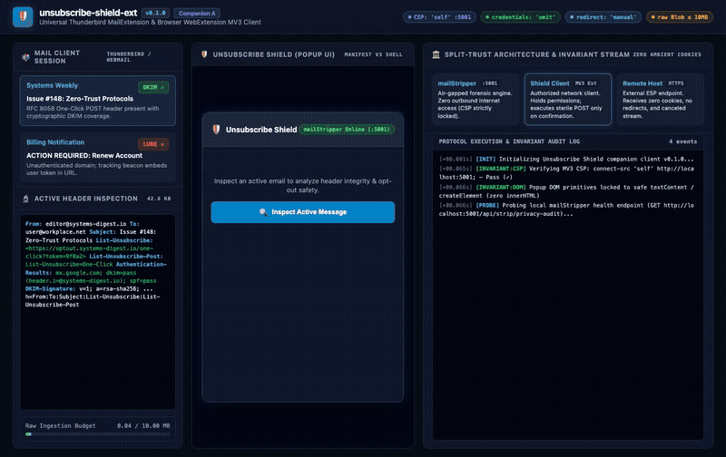

# unsubscribe-shield-ext 🛡️✉️

> Universal **Thunderbird MailExtension** & **Browser WebExtension (Manifest V3)** for air-gapped email unsubscribe forensics & sterile zero-cookie RFC 8058 execution.

Part of the `@knowthankyew` open-source email privacy suite:
- **Companion A (This Repository)**: [`knowthankyew/unsubscribe-shield-ext`](https://github.com/knowthankyew/unsubscribe-shield-ext) — User-facing client extension holding user-authorized network execution permissions.
- **The Core Forensic Engine**: [`knowthankyew/mail-stripper`](https://github.com/knowthankyew/mail-stripper) (`http://localhost:5001`) — Air-gapped forensic analysis engine with zero outbound internet access.
- **Companion B**: [`knowthankyew/mail-stripper-imap`](https://github.com/knowthankyew/mail-stripper-imap) — Headless background daemon for autonomous IMAP IDLE sweeps and automated folder segregation.

---

## 📺 Interactive Demonstration

Watch the complete Unsubscribe Shield workflow in action—from mailbox header inspection and raw MIME stream dispatch to forensic verdict rendering, reconnaissance disclosure, user confirmation, and sterile RFC 8058 execution:



> 📹 **High-Definition Recording**: [`demo.mp4`](demo.mp4) *(Playwright automated run, 1366x860)*  
> 🔄 **Automated Reproduction**: To re-record this demonstration at any time, run: `./scripts/record-demo.sh`

---

## 🎯 The Real-World Case: Why "Unsubscribe" Is Dangerous

Modern email users face an aggressive ecosystem of unsolicited marketing sequences, cold outbound sales trackers, and deceptive phishing lures. When attempting to opt out using traditional mail client buttons or manual browser links, users routinely expose themselves to significant privacy and security hazards:

1. **Active-Inbox Reconnaissance Traps**:  
   Adversarial senders deliberately embed unauthenticated tracking beacons and deceptive unsubscribe links. When a recipient clicks a naive opt-out link or loads an unvetted remote URL, the remote server logs the HTTP request. This signals that the targeted mailbox is monitored by an active human recipient, immediately escalating the recipient's risk profile and resulting in intensified phishing campaigns, targeted credential harvesting, or resale to secondary spam brokers.

2. **Ambient Cookie Leaks & Session Contamination**:  
   Standard web browsers automatically attach ambient cookies, bearer authorization headers, and saved session identifiers when following links. An untrusted opt-out page can leverage cross-origin redirects to siphon session state, leak corporate IP addresses, or trigger cross-site request forgery (CSRF) against internal applications.

3. **Deceptive Opt-Out Portals & Multi-Hop Redirect Chains**:  
   Attackers frequently mimic legitimate ESP unsubscribe flows, presenting deceptive landing pages designed to capture credentials or executing rapid redirect hop chains (`301`/`302`/`307`) that bypass browser perimeter security controls.

4. **MIME Byte Corruption in Naive Extensions**:  
   Conventional browser extensions frequently convert message content to UTF-8 text strings before transmission. This breaks 8-bit European and CJK encodings, invalidates DKIM signatures, and corrupts multi-part MIME boundaries before the forensic engine can analyze them.

---

## 🛡️ The Real-World Solution: Split-Trust Client Architecture

`unsubscribe-shield-ext` solves this threat model by operating as the user-authorized network companion to `mailStripper`:

```
┌─────────────────────────────────┐
│     Mail Client Host            │
│  (Thunderbird / Webmail MV3)    │
└────────────────┬────────────────┘
                 │
                 │ 1. Raw 8-bit MIME Stream (≤ 10 MB)
                 ▼
┌─────────────────────────────────┐       2. Forensic Verdict &        ┌──────────────────────────────────┐
│       Local mailStripper        │ ─────────────────────────────────> │      unsubscribe-shield-ext      │
│        Forensic Engine          │    Reconnaissance Warning Modal    │      (User-Facing Client)        │
│    (http://localhost:5001)      │                                    └────────────────┬─────────────────┘
│   [AIR-GAPPED: Zero Egress]     │                                                     │
└─────────────────────────────────┘                                                     │ 3. Explicit User Confirmation
                                                                                        │    (Acknowledges Recon Warning)
                                                                                        ▼
                                                                       ┌──────────────────────────────────┐
                                                                       │     Remote ESP Target (:443)     │
                                                                       │   POST List-Unsubscribe=One-Click │
                                                                       │   • credentials: 'omit'          │
                                                                       │   • redirect: 'manual'           │
                                                                       │   • res.body?.cancel()           │
                                                                       └──────────────────────────────────┘
```

### The Three-Tier Split-Trust Model

1. **The Air-Gapped Core ([`mailStripper`](https://github.com/knowthankyew/mail-stripper))**:  
   Enforces an absolute zero-egress boundary in its web UI (`connect-src 'self' http://localhost:8000;`) with **zero outbound internet access**, while exposing its local forensic analyzer on loopback (`http://localhost:5001/api/strip/file`). It parses raw RFC 822 MIME bytes locally, evaluates RFC 8058, RFC 2369, RFC 6376 (DKIM), and RFC 8601 (receiving MX) header integrity, defangs links, and calculates forensic risk scores without initiating external network requests.

2. **The User Client ([`unsubscribe-shield-ext`](https://github.com/knowthankyew/unsubscribe-shield-ext))**:  
   The interactive desktop and browser client holding user-authorized network execution permissions. It interfaces directly with Thunderbird or browser webmail, streams raw bytes to local `mailStripper:5001`, displays an unignorable Active-Inbox Reconnaissance Warning modal, and fires sterile RFC 8058 One-Click HTTP POST requests **only upon explicit user confirmation**.

3. **The Autonomous Daemon ([`mail-stripper-imap`](https://github.com/knowthankyew/mail-stripper-imap))**:  
   The headless companion daemon monitoring remote mailboxes via IMAP IDLE push notifications, segregating suspicious lures into `@Safe-Unsubscribe/Quarantine`, and generating in-mailbox cryptographic audit records.

---

## 🏛️ Comprehensive Architectural Invariants

Within the `@knowthankyew` open-source privacy portfolio, `unsubscribe-shield-ext` operates under non-negotiable architectural boundaries:

| # | Architectural Invariant | Implementation Mechanism | Architectural & Security Guarantee |
|:--|:------------------------|:-------------------------|:-----------------------------------|
| **1** | **Zero Ambient Cookies** | `credentials: 'omit'` | Outbound opt-out HTTP requests strictly discard ambient browser session cookies, authorization headers, and stored tokens. |
| **2** | **Manual Redirect Blocking** | `redirect: 'manual'` | Automatically halts redirect follow chains (`301`/`302`/`307`), preventing open-redirect tracking hops and malicious cross-site redirects. |
| **3** | **Byte-Exact Raw MIME Streaming** | `Blob` multipart / `FormData` | Streams raw 8-bit octet buffers directly to `:5001` without UTF-8 string conversions, preventing corruption of European/CJK charsets or DKIM signatures. |
| **4** | **Immediate Response Disposal** | `await res.body?.cancel()` | Terminates and drops incoming HTTP response payload streams immediately upon reading status headers, thwarting tracking pixels or oversized payloads. |
| **5** | **Strict Manifest V3 CSP** | `connect-src 'self' http://localhost:5001;` | Browser runtime strictly prevents outbound connections to arbitrary endpoints. Outbound HTTP is locked to loopback analyzer and sterile executor. |
| **6** | **Safe DOM Primitives** | Zero `innerHTML` interpolation | Popup and UI components use safe DOM primitives (`textContent`, `createElement`, `classList`), eliminating Cross-Site Scripting (XSS) vectors. |
| **7** | **Active-Inbox Recon Warning** | Mandatory confirmation dialog | Enforces mandatory user acknowledgment before remote contact, ensuring users are conscious that opt-out confirms an active mailbox to the sender. |
| **8** | **Client Ingestion Budget** | `MAX_EMAIL_BYTE_SIZE = 10 MB` | Rejects oversized message bodies client-side before memory allocation or transmission, preventing memory exhaustion. |
| **9** | **Dynamic Claims Parity** | `scripts/audit-claims.mjs` | Automated linter verifies all invariants, scans documentation for banned vocabulary, and dynamically verifies test counts against Vitest. |

---

## 🚀 Quickstart (Zero-Coder "Just Works")

Clone the repository and run:

```bash
./start.sh
```

`start.sh` automatically installs dependencies, executes the architectural claims audit, runs the test suite, builds the extension bundle, and opens the interactive preview.

*(Prerequisite: [Node.js](https://nodejs.org/) >= 20 installed).*

---

## 📦 Installation & Loading

### Mozilla Thunderbird (MailExtension)
1. Build the production extension bundle:
   ```bash
   npm run build
   ```
2. Open Thunderbird and navigate to **Tools** > **Add-ons and Themes** (or `Ctrl+Shift+A` / `Cmd+Shift+A`).
3. Click the gear icon (⚙️) and select **Debug Add-ons**.
4. Click **Load Temporary Add-on...** and select `manifest.json` from this repository.

### Google Chrome / Brave / Edge (WebExtension MV3)
1. Build the production bundle:
   ```bash
   npm run build
   ```
2. Navigate to `chrome://extensions` in your browser.
3. Enable **Developer mode** (toggle in upper right).
4. Click **Load unpacked** and select the repository root directory (containing `manifest.json`).

---

## 🧪 Testing & Verification

The test suite and claims linter verify all security guarantees and invariant bounds:

- **Vitest Unit Tests (6/6 automated unit tests pass)**:
  Verifies sterile executor parameters (`credentials: 'omit'`, `redirect: 'manual'`, stream cancel), 10 MB size bounds, and raw byte preservation:
  ```bash
  npm run test:unit
  ```

- **Playwright End-to-End Suite (2/2 e2e tests pass)**:
  Verifies popup rendering, status indicators, and the Active-Inbox Reconnaissance Warning modal flow:
  ```bash
  npm run test:e2e
  ```

- **Architectural Claims & Security Invariant Audit**:
  Verifies strict CSP locking, sterile dispatch policy, safe DOM construction, and documentation parity:
  ```bash
  npm run audit:claims
  ```

- **Automated Demo Walkthrough Re-Recording**:
  ```bash
  ./scripts/record-demo.sh
  ```

---

## 🛡️ Security & Privacy Guarantees

- **No Remote Telemetry**: Zero analytics, external scripts, or tracking libraries.
- **Strict HTTPS Scheme Enforcement**: Rejects non-HTTPS targets fail-closed before initiating network contact.
- **No Referrer Header**: Configures `referrerPolicy: 'no-referrer'` to ensure zero origin or browser state is disclosed.
- **Fail-Closed Dependency Audit**: `npm audit` enforced fail-closed in continuous integration.

---

## 📄 License & Disclosures

- [MIT License](LICENSE)
- [Third-Party Disclosures](NOTICE.md)
