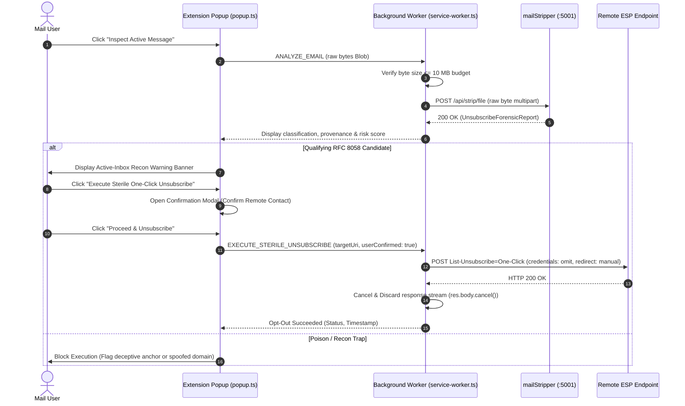

<!-- diagram-meta
  last-validated: 2026-11-08
  validated-commit: 6233993
  covers: [src/**, tests/**]
  generated-by: manual
-->

# Architecture & Invariants Specification: Unsubscribe Shield Extension

> Universal Thunderbird MailExtension & Browser WebExtension (Manifest V3) for air-gapped unsubscribe forensics & sterile zero-cookie RFC 8058 execution.

---

## 1. Executive Summary

`unsubscribe-shield-ext` is a companion client in the `knowthankyew` email privacy suite. While `mailStripper` enforces an absolute zero-egress air-gap within its repository boundary, `unsubscribe-shield-ext` provides the user-facing client layer: extracting raw message bytes from Thunderbird or webmail sessions, querying local `mailStripper` (`http://localhost:5001`) for forensic verdicts, and—only upon explicit user confirmation—executing isolated, sterile RFC 8058 One-Click HTTP POST requests (`credentials: 'omit'`, `redirect: 'manual'`) with immediate response stream disposal.

---

## 2. System Architecture & Component Interactions

### A. Execution Topology

```mermaid
flowchart TD
    subgraph ClientHost["1. Mail Client Host (Thunderbird / Browser)"]
        MailUI["📨 Active Message Viewer"]
        PopupUI["🛡️ Shield Action Popup<br/><code>src/popup/popup.ts</code>"]
        Modal["⚠️ Recon Warning Modal<br/><code>src/popup/index.html</code>"]
    end

    subgraph ExtensionCore["2. WebExtension Service Worker Core (MV3)"]
        Background["⚙️ Background Dispatcher<br/><code>src/background/service-worker.ts</code>"]
        MSClient["📡 Raw MIME Client<br/><code>src/core/mail-stripper-client.ts</code>"]
        SterileExec["🔒 Sterile RFC 8058 Executor<br/><code>src/core/sterile-executor.ts</code>"]
    end

    subgraph LocalEngine["3. Local Ingestion Plane (:5001)"]
        MailStripper["✉️ mailStripper Ingestion Core<br/><code>http://localhost:5001/api/strip/file</code>"]
    end

    subgraph RemoteTarget["4. Remote ESP Opt-Out Endpoint"]
        ESPEndpoint["🌐 Authenticated HTTPS Target<br/><i>POST List-Unsubscribe=One-Click</i>"]
    end

    MailUI --> PopupUI
    PopupUI -->|"Inspect Message"| Background
    Background --> MSClient
    MSClient -->|"POST raw bytes (multipart)"| MailStripper
    MailStripper -->> MSClient: Return Forensic Report
    MSClient -->> PopupUI: Render Verdict & Recon Warning

    PopupUI -->|"Click Unsubscribe"| Modal
    Modal -->|"User Acknowledges Warning"| Background
    Background --> SterileExec
    SterileExec -->|"Sterile POST (credentials: omit)"| ESPEndpoint
    ESPEndpoint -->> SterileExec: Status Only (Immediate Stream Cancel)
    SterileExec -->> PopupUI: Report Success & Audit Timestamp

    classDef client fill:#0f172a,stroke:#64748b,stroke-width:1px,color:#f8fafc;
    classDef core fill:#1e293b,stroke:#38bdf8,stroke-width:2px,color:#f8fafc;
    classDef local fill:#14532d,stroke:#22c55e,stroke-width:2px,color:#f8fafc;
    classDef remote fill:#78350f,stroke:#f59e0b,stroke-width:2px,color:#f8fafc;

    class MailUI,PopupUI,Modal client;
    class Background,MSClient,SterileExec core;
    class MailStripper local;
    class ESPEndpoint remote;
```

### B. Message Inspection & Sterile Execution Sequence



---

## 3. Core Architectural Invariants

| # | Invariant | Enforcement & Guarantee |
|:--|:----------|:------------------------|
| 1 | **Strict Manifest CSP** | Extension pages locked to `connect-src 'self' http://localhost:5001;`. Zero arbitrary third-party analytics or telemetry. |
| 2 | **Byte-Preserving Ingestion** | Uses raw byte arrays / `Blob` multipart streaming. Never calls `Blob.text()`, preventing 8-bit non-UTF-8 corruption. |
| 3 | **10 MB Size Budgeting** | Rejects messages $> 10\text{ MB}$ client-side before memory allocation or transmission. |
| 4 | **Zero-Cookie Sterile POST** | Enforces `credentials: 'omit'`, `redirect: 'manual'`, `referrerPolicy: 'no-referrer'`, and immediate `res.body?.cancel()`. |
| 5 | **Mandatory Active-Inbox Warning** | Requires explicit user confirmation acknowledging sender contact before executing any remote network call. |
| 6 | **Safe DOM Construction** | Zero `innerHTML` interpolation of untrusted strings; pure DOM primitives (`textContent`, `createElement`). |
